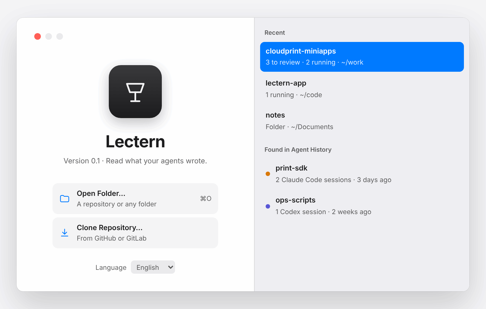

# Lectern

English · [简体中文](README.zh-CN.md)

> A reading-first native IDE for reviewing AI-written code. Rust + GPUI, macOS.

Agents write most of the code now; your time goes into reading it and deciding whether it's right. Lectern is a native macOS app built for that job. It is not an editor. Open a project or folder and you first see the Claude Code and Codex sessions waiting for your review. Read each session turn by turn — what you asked, what the agent said, what it changed — and send review notes back to the session in one batch when something is off. Monorepos and multiple git worktrees are first-class. The UI is English-first, with Simplified Chinese.

**Status: P0, scaffolding. Nothing usable yet.**

## Design

Mockups from the [interaction design](docs/design/interaction.md); the app itself isn't built yet. Screenshots follow your light or dark setting.

**Review a session.** Read a session turn by turn: the prompt, the agent's explanation, and the diff it produced. Leave notes on lines; the context panel shows callers and tests of the changed symbol.

<picture>
  <source media="(prefers-color-scheme: dark)" srcset="docs/images/review-dark.png">
  
</picture>

**Project overview.** Opening a project shows the sessions waiting for review, what's still running, and changes made outside any session.

<picture>
  <source media="(prefers-color-scheme: dark)" srcset="docs/images/overview-dark.png">
  
</picture>

**Worktrees.** Agents running in parallel worktrees, with their changes side by side and overlap warnings.

<picture>
  <source media="(prefers-color-scheme: dark)" srcset="docs/images/worktrees-dark.png">
  
</picture>

**Usage.** Tokens per day and per session, API-equivalent cost, and the Codex and Claude Code limit windows.

<picture>
  <source media="(prefers-color-scheme: dark)" srcset="docs/images/usage-dark.png">
  
</picture>

**Open a project.** Start from a folder or repository; projects found in agent history are listed too.

<picture>
  <source media="(prefers-color-scheme: dark)" srcset="docs/images/welcome-dark.png">
  
</picture>

## Questions it answers

| Question | How Lectern answers it | Phase |
|---|---|---|
| What changed? | Changes split by agent session and turn, rebuilt from Claude Code edits and Codex patches | P1 |
| Why? | Each hunk shows the prompt that caused it and the agent's explanation | P1 |
| How do I get the agent to fix it? | Review notes on lines, batched and sent back to the session with file and line | P1 |
| What else does it affect? | Callers and related tests for changed symbols, in a context drawer | P2 |
| Is it right? | Structural diff, per-file "reviewed" marks, tests run in the terminal | P2 |
| What did it cost? | Tokens per session and turn; Codex and Claude Code limit windows | P1 / P2 |

## How it's built

Single-process Rust, macOS (Apple Silicon) first.

| Layer | Choice |
|---|---|
| UI | [GPUI](https://github.com/zed-industries/zed/tree/main/crates/gpui) + [gpui-component](https://github.com/longbridge/gpui-component) |
| Terminal | [libghostty-vt](https://github.com/ghostty-org/ghostty) core, grid drawn in GPUI |
| Highlighting / index | tree-sitter |
| Git / diff | gix + imara-diff |
| Agents | Local Claude Code / Codex JSONL sessions; ACP later |
| Forges | GitHub and GitLab (including self-hosted) |
| UI strings | Fluent, en + zh-CN |

Everything is a plugin: the kernel only loads plugins and manages their lifecycle. Built-in plugins are linked at compile time; third-party plugins run as separate processes.

## Performance budget (Apple Silicon, targets)

| Metric | Budget |
|---|---|
| Cold start to first frame | < 150 ms |
| Open project to project home | < 100 ms |
| Open file to highlighted first screen | < 16 ms |
| Open a session's diff | < 50 ms |
| Switch worktree / branch | < 100 ms |
| Idle memory | < 150 MB |
| Scrolling and input | steady 120 fps |

## Roadmap

| Phase | Time | Scope | Exit gate |
|---|---|---|---|
| P0 Setup | 1–2 weeks | Agent-friendly scaffolding, i18n, libghostty-vt grid rendering, UI probe, benchmarks | G1: all three spikes work |
| P1 MVP | 4–6 weeks | Open project, project home, turn-by-turn review, review notes, terminal + session resume, project model | G2: usable daily |
| P2 Understand | ~4 weeks | Symbol index + Java parsing, context drawer (impact), structural diff, full-file reading and editing | G3: Java navigation usable daily |
| P3 Agent-native | 4+ weeks | ACP conversation panel, MR view, dependency sources, permission prompts | — |

Progress: [Milestones](https://github.com/SoloJiang/lectern-app/milestones) · [docs/roadmap.md](docs/roadmap.md)

## Docs

Design docs are in Chinese for now.

- [Interaction spec](docs/design/interaction.md) · [design canvas](https://claude.ai/artifact/LVSXNi9xPviRgzdycnskp9)
- [Technical research: Rust + GPUI](docs/design/tech-research.md)
- [Architecture decision records](docs/adr/)
- [AGENTS.md](AGENTS.md): rules for coding agents working in this repo

## License

Dual-licensed under MIT or Apache-2.0, at your option. See [LICENSE-MIT](LICENSE-MIT) and [LICENSE-APACHE](LICENSE-APACHE).

Lectern borrows ideas from Zed but copies none of its GPL code.
