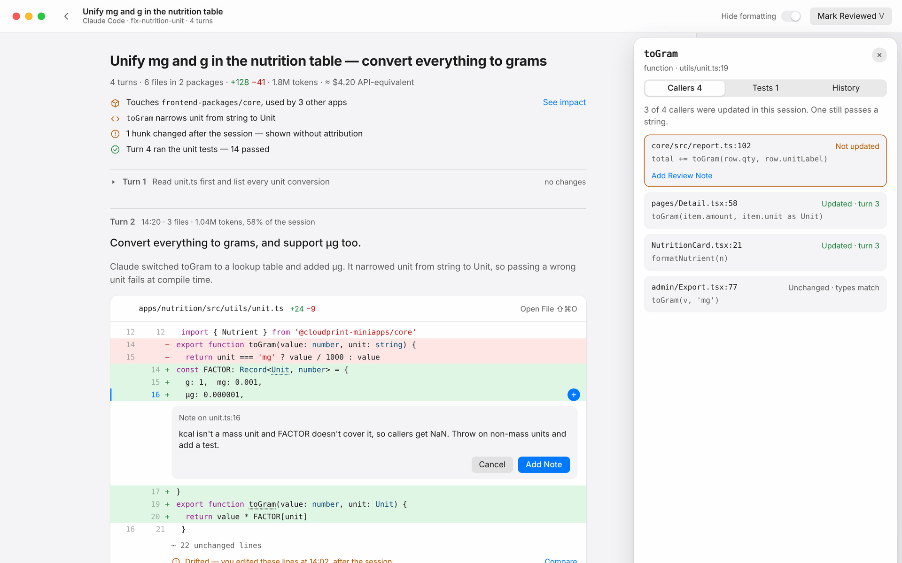
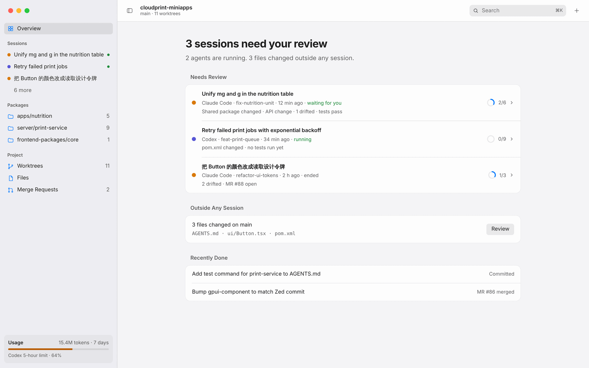
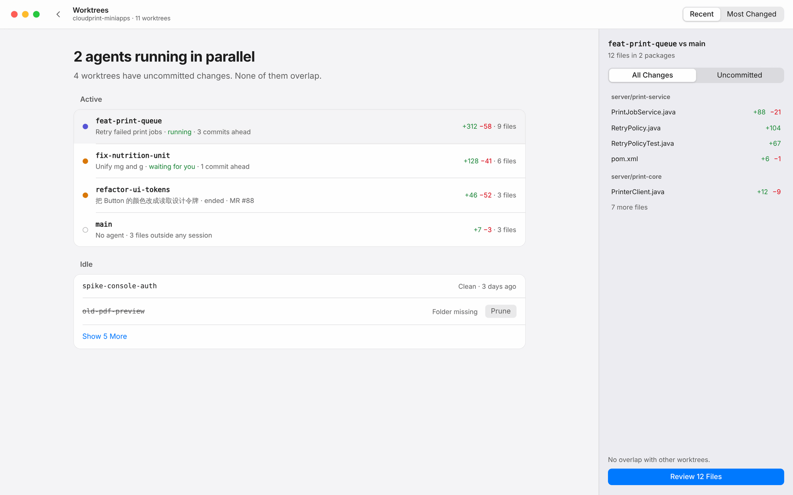
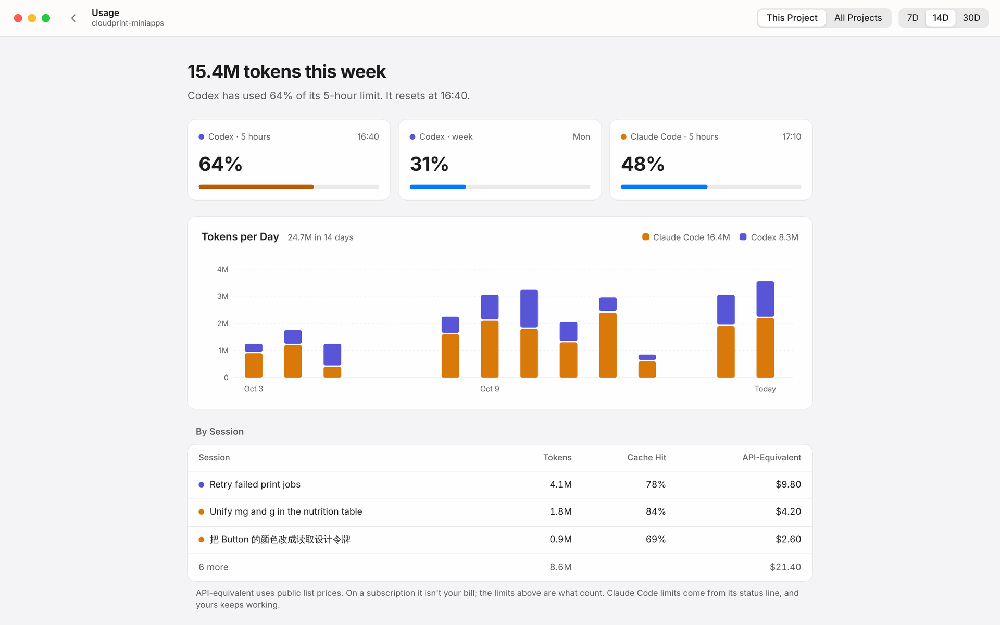

# Lectern

English · [简体中文](README.zh-CN.md)

**Read what your agents wrote.**

Lectern is a native macOS app for reviewing the code that Claude Code and Codex write for you. It isn't an editor. It's where you sit down to read: what you asked for, what the agent did, and whether it's right.

<picture>
  <source media="(prefers-color-scheme: dark)" srcset="docs/images/review-dark.png">
  
</picture>

## Start from your project

Open a folder or repository and Lectern shows what needs your attention: the agent sessions waiting for review, the ones still running, and anything that changed outside a session. Monorepos and git worktrees work out of the box.

<picture>
  <source media="(prefers-color-scheme: dark)" srcset="docs/images/overview-dark.png">
  
</picture>

## Read a session like a story

Each session unfolds turn by turn: your prompt, the agent's explanation, and the diff it produced, in that order. Changes are tied to the turn that caused them, so you rarely have to guess why a line moved. Lines edited after the session are marked as such, so you know what the agent didn't write; sessions in a format Lectern doesn't recognize fall back to a plain file-by-file diff.

- **See the impact.** The context panel lists callers and tests of every changed symbol, and flags callers the agent missed.
- **Send notes back.** Comment on lines as you read. Notes collect into one batch and go back to the session with file and line, ready for the agent's next turn.
- **Hide the noise.** Formatting-only changes fold away, and files you've reviewed stay marked.

## Watch agents work in parallel

Run several agents in separate worktrees and see them side by side: what each one changed, how far ahead it is, and whether any two are touching the same files.

<picture>
  <source media="(prefers-color-scheme: dark)" srcset="docs/images/worktrees-dark.png">
  
</picture>

## Know what it cost

Tokens per session and per turn, the API-equivalent cost, and how much of your Codex and Claude Code limits you've used. Claude Code's status line feeds Lectern directly, so limit windows are live.

<picture>
  <source media="(prefers-color-scheme: dark)" srcset="docs/images/usage-dark.png">
  
</picture>

## Fast, and at home on the Mac

These are the budgets Lectern is built against ([ADR 0017](docs/adr/0017.md), [ADR 0018](docs/adr/0018.md)); CI benchmarks will hold every change to them.

- **Opens instantly.** First frame on screen in under 20 ms; everything else loads after.
- **Light.** Under 60 MB of memory with a window open, under 100 MB with a large monorepo. No language servers or runtimes running in the background.
- **Small.** The app is under 80 MB. Extra languages, forges and agent adapters download from the plugin marketplace only when a project needs them, and plugins that run code are sandboxed to the permissions they declare.
- **Native.** System fonts, colors and controls, light and dark, with motion that follows macOS.

## Works with

- **Agents:** Claude Code and Codex, read from their local session files
- **Forges:** GitHub and GitLab, including self-hosted
- **Languages:** English and Simplified Chinese

## Status

Lectern is in early development and not ready to use yet. The screenshots above are from the [interaction design](docs/design/interaction.md) and follow your light or dark setting.

## Building on Lectern

Lectern is written in Rust on [GPUI](https://github.com/zed-industries/zed/tree/main/crates/gpui) with [gpui-component](https://github.com/longbridge/gpui-component), tree-sitter, gix and [libghostty-vt](https://github.com/ghostty-org/ghostty). Design docs are in Chinese for now:

- [Interaction spec](docs/design/interaction.md) · [design canvas](https://claude.ai/artifact/LVSXNi9xPviRgzdycnskp9)
- [Technical research](docs/design/tech-research.md) · [Architecture decisions](docs/adr/)
- [AGENTS.md](AGENTS.md): how coding agents work in this repo

## License

MIT or Apache-2.0, at your option. See [LICENSE-MIT](LICENSE-MIT) and [LICENSE-APACHE](LICENSE-APACHE). Lectern borrows ideas from Zed but copies none of its GPL code.
